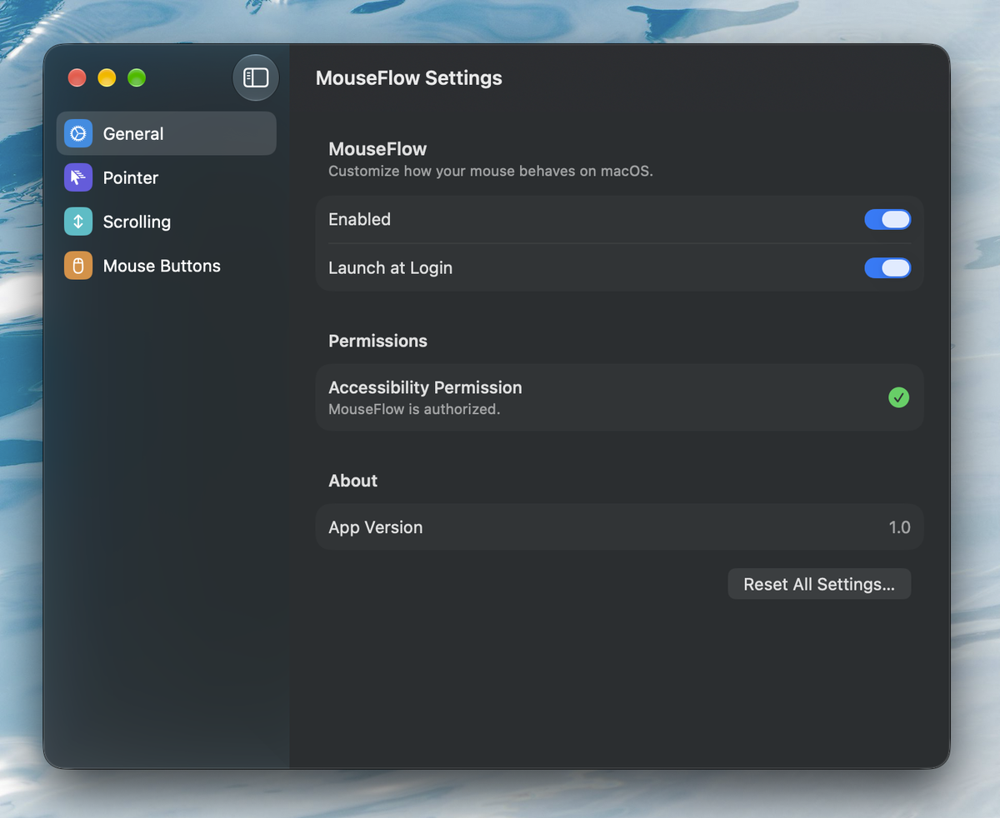
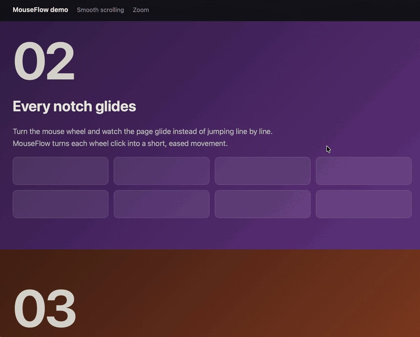
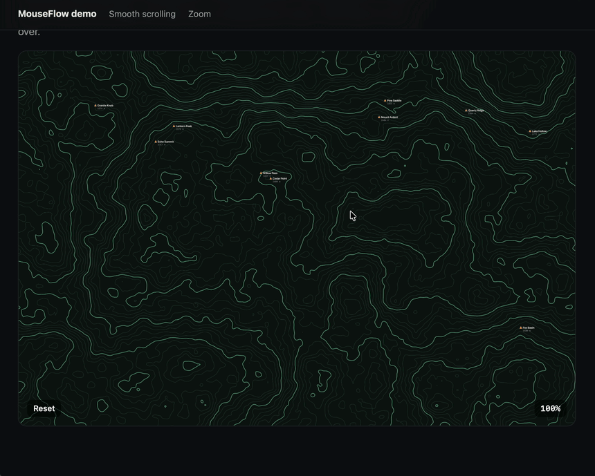

# MouseFlow

**Make your mouse feel right on a Mac.** MouseFlow is a small menu-bar app for external mice. It fixes scroll direction and speed, sets pointer speed, and lets every mouse button do something useful. Your trackpad stays exactly as it is.

Free, open source, macOS 13 or later.



## What it does

### Scroll the way you want

Flip the mouse wheel without flipping the trackpad. Pick the speed, turn on smooth scrolling, or scroll a fixed number of lines per click.



### Hold a key while scrolling

- **Zoom**: pinch-zoom in maps, photos and browsers.
- **Horizontal**: scroll sideways through timelines and wide pages.
- **Fast**: scroll 3× faster through long documents.



### Pointer speed that sticks

Set how fast the pointer moves, with Mac acceleration turned off. Hold the **Precision Mode** key or button to slow it down for fine work.

### Give every button a job

Set each mouse button to:

- Switch desktops, open Mission Control or show the desktop
- Go back or forward in Safari, Finder and other apps
- Play, pause or change volume
- Open an app, a website or a Shortcut
- Press a keyboard shortcut

### Macros

Record a series of key presses, add text and pauses, and play it all back with one click.

## Install

1. Download `MouseFlow-<version>.dmg` from the [latest release](../../releases/latest).
2. Open it and drag **MouseFlow** into **Applications**.
3. Open MouseFlow. The first time, macOS blocks it because it isn't from the App Store. Go to **System Settings › Privacy & Security**, scroll down and click **Open Anyway**. You only do this once.
4. When asked, turn on MouseFlow under **System Settings › Privacy & Security › Accessibility**. It starts working right away.

MouseFlow lives in the menu bar. Click its icon for quick controls, or choose **Settings** for everything else.

## Something wrong?

**MouseFlow is on in Accessibility but does nothing.** This happens after an update. Quit MouseFlow, remove it from the Accessibility list with the **–** button, then open it again and turn it back on.

**Pointer speed feels off after quitting.** Open MouseFlow and quit it again. Or change Tracking speed in **System Settings › Mouse**.

## For developers

Plain Xcode project with no dependencies. Select your own team under **Signing & Capabilities**, or pass `DEVELOPMENT_TEAM=<your team ID>` to `xcodebuild`.

```sh
xcodebuild -project MouseFlow.xcodeproj -scheme MouseFlow -configuration Debug -derivedDataPath build build
open build/Build/Products/Debug/MouseFlow.app --args --settings
```

`scripts/release.sh` builds a release DMG into `build/release/`. Logs use a `[MouseFlow]` prefix:

```sh
log stream --predicate 'eventMessage CONTAINS "[MouseFlow]"' --style compact
```

## License

MIT, see [`LICENSE`](LICENSE). The smooth-scrolling code is licensed under CC BY-NC 4.0, so MouseFlow may not be used commercially. See [`THIRD_PARTY_NOTICES.md`](THIRD_PARTY_NOTICES.md).
